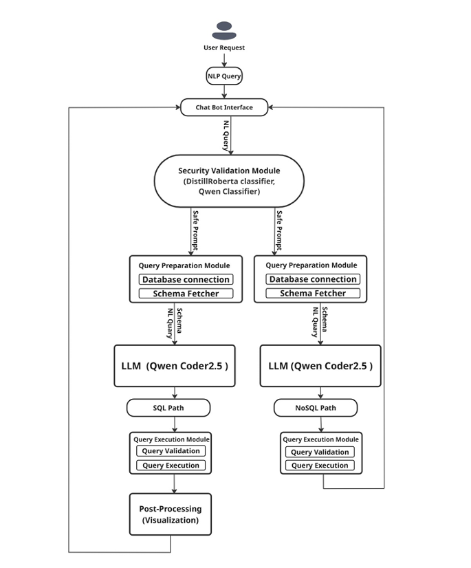

# LexaQuery: Automated Query Generation

An AI-powered, secure, natural-language interface that enables non-technical stakeholders to interact with SQL and NoSQL databases using everyday English.

## Overview

**LexaQuery** is a secure, on-premises chatbot designed to simplify database querying. It allows users to ask questions in natural language and converts their requests into database queries, making data more accessible without requiring users to understand SQL or database query languages.

The system combines Large Language Models (LLMs), database integration, and a dedicated security layer to provide a safer database interaction experience.

## Key Features

- **Natural Language to SQL:** Convert English questions into SQL queries.
- **SQL and NoSQL Support:** Interact with different database types through a unified conversational interface.
- **AI-Powered Query Generation:** Leverage fine-tuned language models for query generation.
- **Security Layer:** Detect and block SQL injection and prompt injection attempts.
- **Read-Only Execution:** Validate generated queries and allow only SELECT statements.
- **Interactive Chatbot:** Provide a conversational interface for database interaction.
- **Chat History:** Maintain user authentication and conversation history.

## System Architecture

The project follows a multi-component architecture:

1. **Frontend:** React-based interface for user interaction.
2. **Backend:** FastAPI for handling requests and coordinating system components.
3. **Language Model:** Qwen2.5-Coder-3B-Instruct for natural-language query generation.
4. **Security Layer:** A DistilRoBERTa-based classifier for detecting prompt injection, combined with SQL validation mechanisms.
5. **Database Integration:** MySQL and Typesense for database querying.
6. **Authentication and Storage:** Firebase for authentication and chat history.
## System Architecture

The following diagram illustrates the overall architecture of LexaQuery and how its main components interact.

  

## Security Layer

One of the main components of LexaQuery is its security mechanism, designed to protect database interactions from malicious inputs.

The security layer focuses on:

- Detecting prompt injection attempts.
- Identifying potentially malicious SQL queries.
- Blocking unauthorized or unsafe database operations.
- Enforcing read-only query execution through SELECT-only validation.

The prompt-injection detection component uses a fine-tuned DistilRoBERTa model.

## Technologies Used

- **Programming Languages:** Python, JavaScript
- **AI & NLP:** Transformers, Qwen2.5-Coder, DistilRoBERTa
- **Backend:** FastAPI
- **Frontend:** React
- **Database:** MySQL, Typesense
- **Authentication & Storage:** Firebase
- **Model Optimization:** Unsloth, 4-bit Quantization

## Research & Publication

This project was presented and published as an IEEE research paper.

**Paper Title:** LexaQuery: Automated Query Generation  
**Conference:** ICICIS 2025  
**Paper ID:** ICICIS2025-89

## Team

- Rana El Nezamy
- Nour Madkor
- Salma Yasser Elezaby
- Rawan Badr

**Supervisor:** Dr. Salsabil Amin

## Project Contribution

My primary contribution focused on designing and implementing the **Security Layer**, including prompt-injection detection and SQL query validation to ensure safer database interactions.

---

*LexaQuery aims to bridge the gap between natural language and database querying, making data access easier, safer, and more accessible to non-technical users.*
